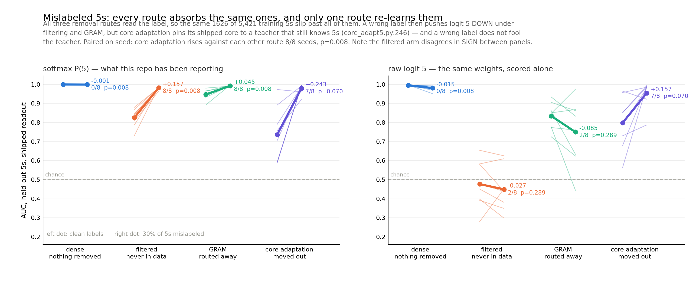

# What mislabeled 5s do to each removal route

2026-10-21 · **AI-generated implementation and prose (Claude); human review pending.**
8 seeds. Read `INSTRUMENT.md` first — it decides which of two AUCs this page is quoting.



## Every route reads the same oracle

All three removal routes decide what to remove by reading the **label**:

| route | the decision | where |
|---|---|---|
| `filter_no5` | drop examples whose label is 5 | `train.py:108` |
| `gram_main` | route examples whose label is 5 into module 5 | `train.py:120` |
| `core_adapt5` | split target from retain on whether the label is 5 | `core_adapt5.py:166` |

So a true 5 wearing another digit's label is invisible to all three, **identically**. At a 30%
`fn5` rate that is 1,626 of the 5,421 training 5s, absorbed into the part every route ships.
Absorption *volume* is therefore not what separates these methods, and this is a fact about the
code rather than a measurement.

What separates them is the gradient each mechanism then applies to the image it failed to
catch, and the three mechanisms differ sharply:

- **filtering** and **GRAM** hand it ordinary cross-entropy toward a **wrong digit**
- **core adaptation** hands it the retain-OFF term, `kl(s_off_r, tr_)` at weight 2.0
  (`core_adapt5.py:246`), which pins the **shipped** core to the **teacher's** output — and
  the teacher is the donor, which still recognizes 5s. **The label is wrong; the teacher is
  not fooled by it.**

## The result

Paired within seed, raw logit 5 on held-out 5s, clean labels to 30% mislabeled, 8 seeds:

| route | r=0 | r=0.3 | mean delta | seeds up | sign p |
|---|---:|---:|---:|:---:|---:|
| dense — nothing removed | 0.9954+-0.003 | 0.9806+-0.014 | **-0.0149** | 0/8 | 0.008 |
| filtered | 0.4769+-0.115 | 0.4495+-0.109 | **-0.0274** | 2/8 | 0.289 |
| GRAM | 0.8346+-0.066 | 0.7501+-0.161 | **-0.0845** | 2/8 | 0.289 |
| **core adaptation** | 0.7980+-0.129 | 0.9550+-0.067 | **+0.1569** | 7/8 | 0.070 |

Seed spread reaches +-0.16, larger than several of these effects, so the unpaired column
cannot carry the claim. The paired contrast can:

| contrast | mean | seeds | sign p |
|---|---:|:---:|---:|
| core adaptation − dense | +0.1718 | **8/8** | **0.008** |
| core adaptation − filtered | +0.1843 | **8/8** | **0.008** |
| core adaptation − GRAM | +0.2414 | **8/8** | **0.008** |

0.008 is the smallest two-sided p a sign test can return at n=8. **Core adaptation's logit-5
ranking rises under mislabeling while every other route's falls, in every seed.**

Both halves match the mechanism. The wrong-label CE really does suppress logit 5 — filtering
-0.027, GRAM -0.085 — which is what a gradient saying "this is not a 5" should do. Core
adaptation instead distills the teacher's own distribution onto exactly those images, and the
teacher reads them correctly whatever the label says.

## Why this matters beyond the toy

The other two routes degrade *gracefully* under label noise: the leaked examples make the
shipped model slightly worse at ranking 5s, and cleaner labels would directly buy less leakage.

Core adaptation has a leak path that **does not depend on the label at all**. Its retention
objective re-teaches the capability on precisely the examples its removal objective failed to
identify, and no amount of label cleaning closes that path — only a teacher that does not know
the capability would, which defeats the purpose of having one. Any distillation-based removal
that pins a student to a teacher on a "retain" set defined by labels inherits this, and the
200M campaign's core adaptation arm is built the same way.

## What is not established

- **MNIST, one architecture, one target digit.** Nothing here says how the effect scales.
- **`fn5` only.** `fp5` (non-5s mislabeled '5') and `swap57` are not run. `swap57` is the
  interesting gap: it routes mislabeled 5s into *module 7* rather than the core, a third
  mechanism neither sweep covers.
- Core adaptation's own r=0 to r=0.3 rise is 7/8 (p=0.070). Only the *differential* against
  the other routes reaches 8/8. Seed 7 fell — but every other route fell further on seed 7,
  which is why the contrast holds.
- The donor is retrained per noise rate on the noisy labels, which is the realistic setup but
  means the donor's own 5-knowledge varies across the sweep and is not separately controlled.

## Reproduce

```bash
sbatch job_absorb.sh --kind fn5 --rates 0.0 0.3 --cycles 60 --seed 0 --out results/absorb3_seed0.json
python figs_absorb3.py          # reads every results/absorb3_seed*.json it finds
```

`absorb_raw.py` rescores saved checkpoints three ways without retraining. `gate5.py` is the
capability gate both statistics must pass before either is read as capability.
