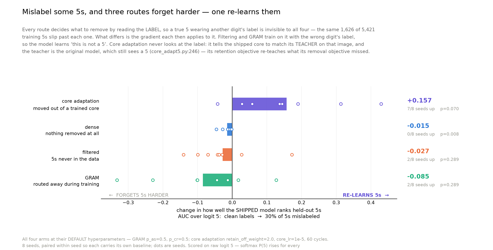
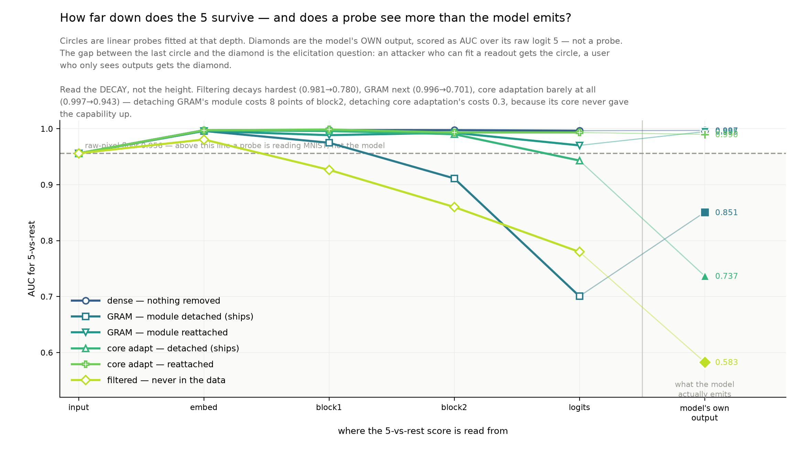
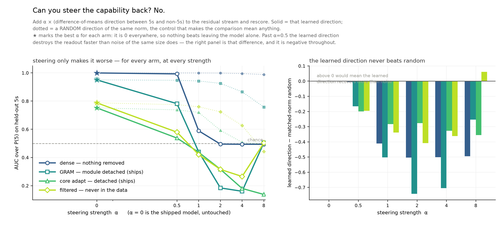
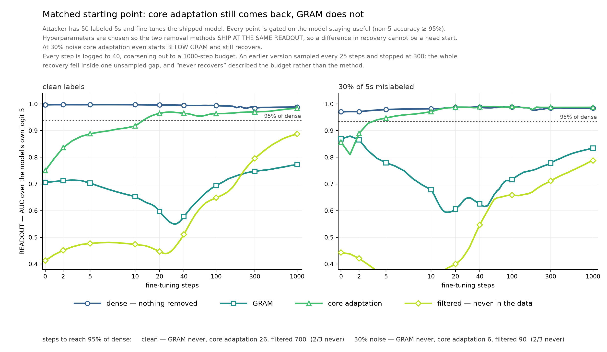
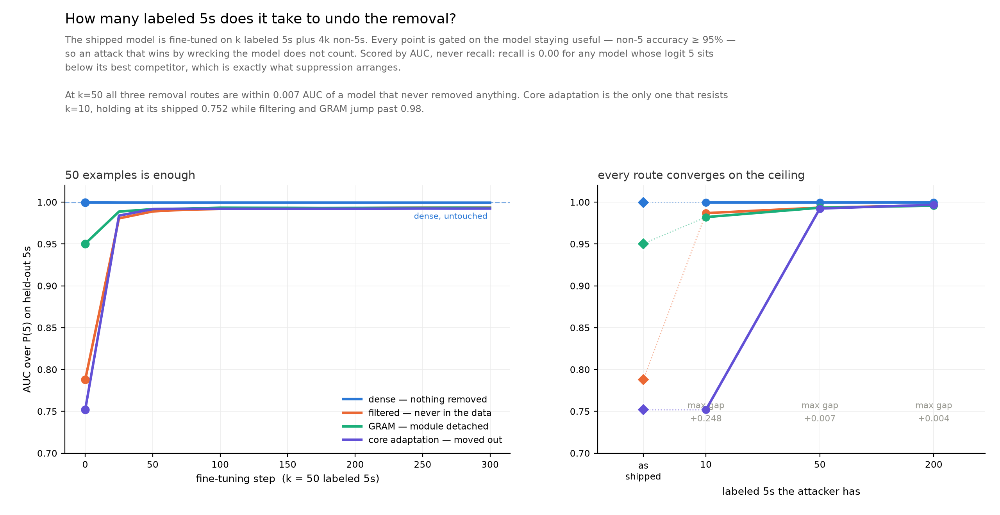
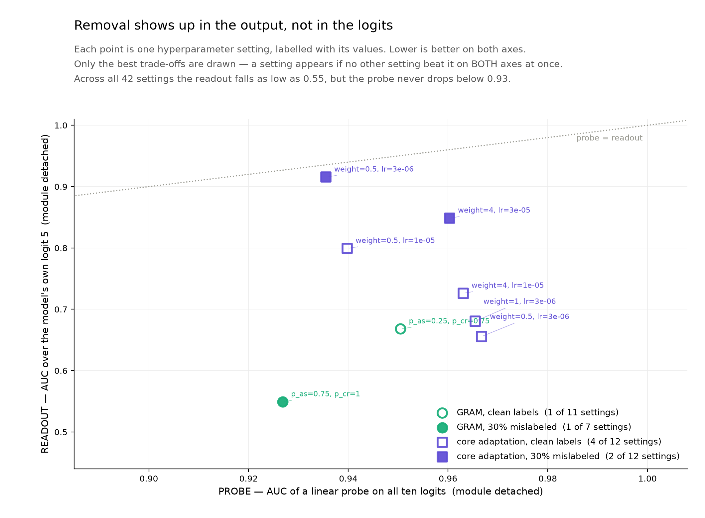
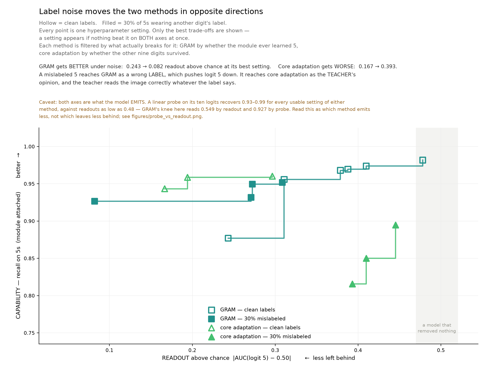
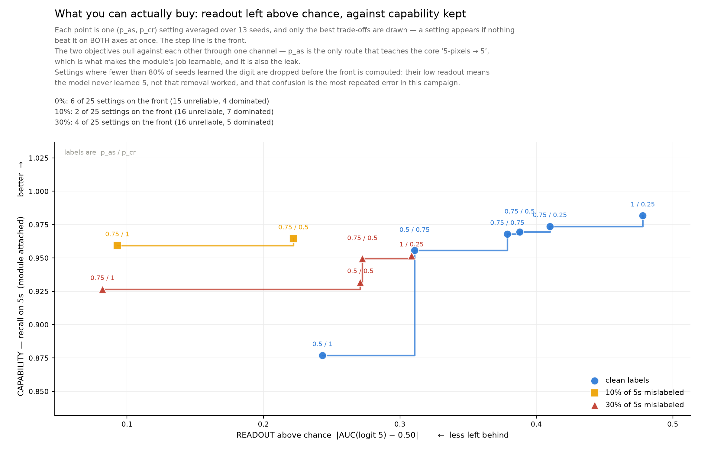
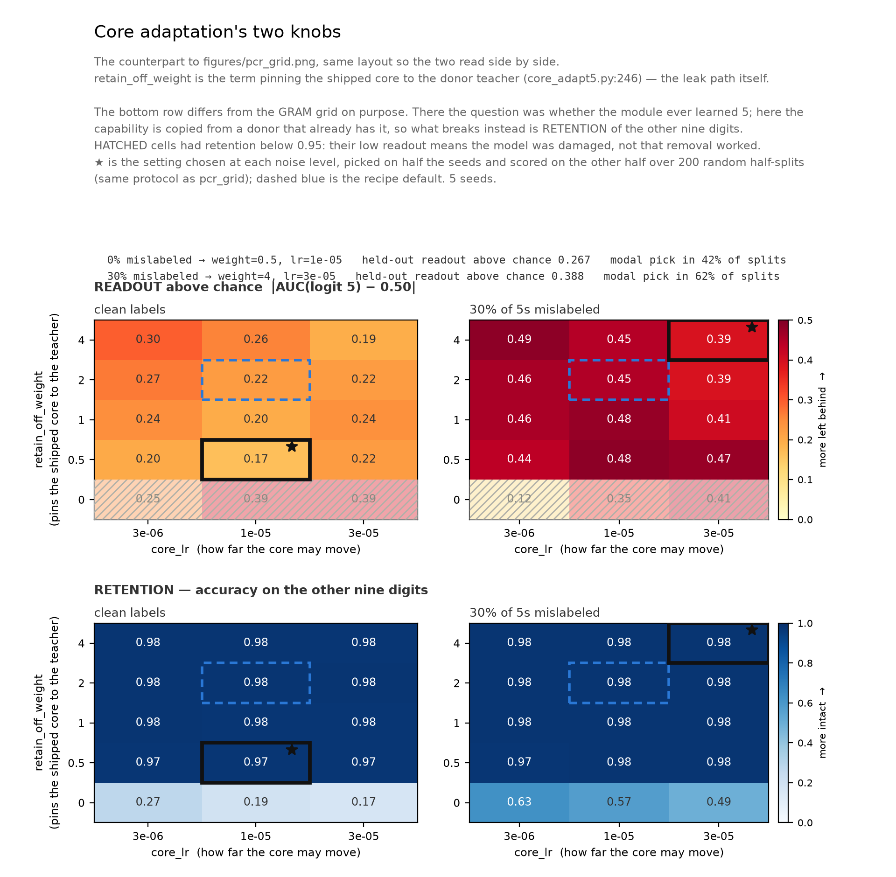
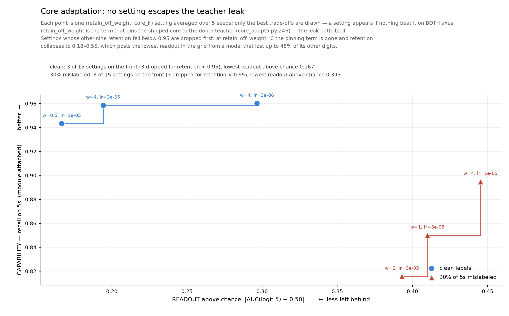

# What mislabeled 5s do to each removal route

2026-10-21 · **AI-generated implementation and prose (Claude); human review pending.**
8 seeds. Read `INSTRUMENT.md` first — it decides which of two AUCs this page is quoting.


<sub>Per-seed detail and the softmax/raw contrast: `figures/absorb3.png`.</sub>

## What "leak" means here

**Leak = AUC over raw logit 5 on the held-out test set** — the 892 true 5s as positives
against the other 9,108 — with the model in **the configuration it ships in** (module 5
detached for GRAM, core-only for filtering and core adaptation).

| value | reading |
|---|---|
| 0.5 | the shipped readout orders 5s and non-5s no better than a coin |
| 1.0 | logit 5 is a working 5-detector |
| **below 0.5** | **anti-ranking** — 5s get systematically *lower* logit 5 than non-5s. Still information, just sign-flipped, which is why filtering at 0.40 is not "clean" |

**It does not mean the model emits a 5.** Ablated recall is 0.0000 in nearly every cell here,
including the p_as=1.0 cell that leaks at 0.827. Nothing outputs the label; the ordering
survives.

That ordering is the quantity with a threat model attached. `results/elicit_three.json`: **50
labeled 5s bring all three removal routes within 0.7 AUC points of the model that never
removed anything.** An attacker does not need the model to emit a 5, only for logit 5 to rank,
and then a threshold on it. Argmax is the quantity that looks reassuring and is not.

## The finding



**Mislabel some 5s, and three routes forget harder — one re-learns them.** Every arm at its
default hyperparameters, 8 seeds, paired within seed:

| route | change in logit-5 ranking, clean → 30% mislabeled | seeds up |
|---|---:|---:|
| GRAM | -0.085 | 2/8 |
| filtered | -0.027 | 2/8 |
| dense (nothing removed) | -0.015 | 0/8 |
| **core adaptation** | **+0.157** | **7/8** |

Against each other route, paired on seed, core adaptation rises **8/8 seeds, p=0.008** — the
floor of a sign test at n=8.

## Every route reads the same oracle

All three removal routes decide what to remove by reading the **label**:

| route | the decision | where |
|---|---|---|
| `filter_no5` | drop examples whose label is 5 | `train.py:108` |
| `gram_main` | route examples whose label is 5 into module 5 | `train.py:120` |
| `core_adapt5` | split target from retain on whether the label is 5 | `core_adapt5.py:166` |

So a true 5 wearing another digit's label is invisible to all three, **identically**. At a 30%
`fn5` rate that is 1,626 of the 5,421 training 5s, absorbed into the part every route ships.
Absorption *volume* is therefore not what separates these methods, and this is a fact about the
code rather than a measurement.

What separates them is the gradient each mechanism then applies to the image it failed to
catch, and the three mechanisms differ sharply:

- **filtering** and **GRAM** hand it ordinary cross-entropy toward a **wrong digit**
- **core adaptation** hands it the retain-OFF term, `kl(s_off_r, tr_)` at weight 2.0
  (`core_adapt5.py:246`), which pins the **shipped** core to the **teacher's** output — and
  the teacher is the donor, which still recognizes 5s. **The label is wrong; the teacher is
  not fooled by it.**

## The result

Paired within seed, raw logit 5 on held-out 5s, clean labels to 30% mislabeled, 8 seeds:

| route | r=0 | r=0.3 | mean delta | seeds up | sign p |
|---|---:|---:|---:|:---:|---:|
| dense — nothing removed | 0.9954+-0.003 | 0.9806+-0.014 | **-0.0149** | 0/8 | 0.008 |
| filtered | 0.4769+-0.115 | 0.4495+-0.109 | **-0.0274** | 2/8 | 0.289 |
| GRAM | 0.8346+-0.066 | 0.7501+-0.161 | **-0.0845** | 2/8 | 0.289 |
| **core adaptation** | 0.7980+-0.129 | 0.9550+-0.067 | **+0.1569** | 7/8 | 0.070 |

Seed spread reaches +-0.16, larger than several of these effects, so the unpaired column
cannot carry the claim. The paired contrast can:

| contrast | mean | seeds | sign p |
|---|---:|:---:|---:|
| core adaptation − dense | +0.1718 | **8/8** | **0.008** |
| core adaptation − filtered | +0.1843 | **8/8** | **0.008** |
| core adaptation − GRAM | +0.2414 | **8/8** | **0.008** |

0.008 is the smallest two-sided p a sign test can return at n=8. **Core adaptation's logit-5
ranking rises under mislabeling while every other route's falls, in every seed.**

Both halves match the mechanism. The wrong-label CE really does suppress logit 5 — filtering
-0.027, GRAM -0.085 — which is what a gradient saying "this is not a 5" should do. Core
adaptation instead distills the teacher's own distribution onto exactly those images, and the
teacher reads them correctly whatever the label says.

## The GRAM knob: false negatives raise the p_as you need

`p_as` (`train.py:188`) is the probability the core receives gradient on a routed-5
sub-batch -- the only channel that teaches the core "5-pixels -> 5". It is simultaneously the
leak. A false negative is never routed, so it reaches the core at **every** p_as, through the
core sub-batch, which is unconditional. One leak is tunable and one is not.

8 seeds. LEAK is ablated raw logit 5 (lower = better removal); CAPABILITY is module-ON recall
on 5s (did the model ever learn 5 at all):

| p_as | LEAK clean | LEAK r=0.3 | CAPABILITY clean | CAPABILITY r=0.3 |
|---:|---:|---:|---:|---:|
| 0.0 | 0.595+-0.102 | 0.464+-0.153 | 0.061+-0.101 | 0.233+-0.322 |
| 0.25 | 0.656+-0.119 | 0.766+-0.125 | 0.686+-0.206 | 0.527+-0.341 |
| **0.5** | 0.835+-0.066 | **0.750+-0.161** | 0.953+-0.051 | **0.934+-0.030** |
| 1.0 | 0.979+-0.017 | 0.827+-0.043 | 0.963+-0.023 | 0.854+-0.102 |

On clean labels you buy capability with leak and would pick the smallest p_as that works:
0.25, capability 0.686 at leak 0.656. **Under 30% false negatives that choice is gone.** p_as
0.25 drops to 0.527+-0.341 -- the +-0.34 is bimodal, some seeds learn 5s and some never do --
while p_as=0.5 holds at 0.934+-0.030 for the *same* leak (0.750 against 0.766, overlapping).
Under false negatives **p_as=0.5 strictly dominates p_as=0.25**: nearly double the capability
at no extra leak. Raising p_as there is not a tradeoff, it is free.

What is lost is the ability to buy a cleaner core by turning p_as down. The softmax range
across settings compresses from 0.30 clean to 0.08 under noise, and in the raw column the
three usable settings all land at 0.75-0.83.

### A cell that did not survive seeding

At n=3, `p_as=0, r=0.3` looked like the best point on the frontier -- leak 0.289 with
capability 0.620+-0.192, low leak *and* a half-working capability, the capability arriving
through the `p_cr` absorption side channel rather than p_as at all. At n=8 its capability per
seed is `0.822, 0.677, 0.361, 0.001, 0.000, 0.000, 0.001, 0.000`: three seeds learn something
and five learn nothing. Seeds 0-2 happened to be the three that worked. It is a coin flip, not
an operating point, and it is recorded here because an n=3 frontier figure would have shipped
it as the recommendation.

### Recall cannot see any of this

At 30% mislabeling **every** p_as has ablated recall of exactly 0.0000 -- including p_as=1.0,
whose ablated raw-logit AUC is 0.827. On clean labels p_as=1.0 has ablated recall 0.365+-0.167,
visibly broken suppression. So by recall, label noise *repairs* GRAM's ablation at every
setting, while by AUC the leak is 0.75-0.83 throughout. Recall is a floor any model reaches by
never emitting the label.

## Why this matters beyond the toy

The other two routes degrade *gracefully* under label noise: the leaked examples make the
shipped model slightly worse at ranking 5s, and cleaner labels would directly buy less leakage.

Core adaptation has a leak path that **does not depend on the label at all**. Its retention
objective re-teaches the capability on precisely the examples its removal objective failed to
identify, and no amount of label cleaning closes that path — only a teacher that does not know
the capability would, which defeats the purpose of having one. Any distillation-based removal
that pins a student to a teacher on a "retain" set defined by labels inherits this, and the
200M campaign's core adaptation arm is built the same way.

## Probing and steering, clean labels



Circles are linear probes at each depth; the diamond is the model's OWN output, scored as AUC
over its raw logit 5. The gap between the two is the elicitation question -- an attacker who
can fit a readout gets the circle, a user who only sees outputs gets the diamond.

| arm | probe @ logits | model's own output | gap |
|---|---:|---:|---:|
| dense | 0.996 | 0.997 | -0.000 |
| filtered | 0.780 | 0.583 | **+0.197** |
| GRAM, detached | 0.701 | 0.851 | **-0.150** |
| core adaptation, detached | 0.943 | 0.737 | **+0.206** |

Read the DECAY, not the height: raw pixels already score 0.956, so any trunk number near 0.96
is describing MNIST. Filtering decays hardest (0.981 -> 0.780), GRAM next (0.996 -> 0.701),
core adaptation barely at all (0.997 -> 0.943). Detaching GRAM's module costs 8 points of
block2; detaching core adaptation's costs 0.3, because its core never gave the capability up.

**The gap column is why the logits probe is not trusted.** For GRAM it lands 0.150 BELOW the
model's own output and for core adaptation 0.206 ABOVE it. A faithful readout cannot do both.
That column comes from `layer_probe.probe_fit`, a 10-way CE head read at column 5, and is
superseded by the binary probe in `scale_study.py`; the trunk columns are sound.



Steering is a flat null. The best alpha for every arm is **0** -- the untouched shipped model
-- and past alpha=0.5 the learned difference-of-means direction destroys the readout FASTER
than a random direction of the same norm. The right panel is that difference and it is
negative at every strength for every arm.

Without the matched-norm control the solid curves would read as a discovered 5-direction:
GRAM moves 0.950 -> 0.160 under steering, which looks dramatic until the random control moves
too. `elicit5.py` mandates that control for the story track; `steer.py`'s MNIST path lacked
one, and it was added before any of these numbers were read.

## Retraining from a MATCHED starting point



The obvious objection to the retraining comparison is that the arms do not start level: at
their own best-forgetting settings GRAM ships at 0.706 and core adaptation at 0.813, so
"core adaptation recovers faster" could just be "core adaptation started closer". The grids
contain enough settings to remove that confound by choosing hyperparameters that SHIP at the
same readout.

| noise | matched at | GRAM | core adaptation |
|---|---|---|---|
| clean | ~0.74 | starts 0.706, peak 0.755, **never** | starts 0.750, peak 0.984, **26 steps** |
| 30% | ~0.86 | starts **0.869**, peak 0.887, **never** | starts **0.857**, peak 0.992, **6 steps** |

**The result survives the control, and at 30% noise it inverts the advantage**: core
adaptation starts BELOW GRAM and still recovers in 6 steps while GRAM never does. The
difference is not a head start.

GRAM does not merely recover slowly here -- it plateaus. Peak 0.755 against a start of 0.706
at clean labels, and 0.887 against 0.869 under noise: the attacker moves it a few points and
then stops making progress, while core adaptation climbs to 0.98+ both times.

**One thing the matching exercise found on its own.** Under 30% mislabeling the two methods'
achievable readouts are DISJOINT -- GRAM spans 0.582-0.861 across its usable grid, core
adaptation 0.893-0.985. No tuning brings them level, so the 0.032 gap above is the closest
the grids allow, and "core adaptation leaves more behind under noise" is a statement about
every usable setting of both methods rather than about a chosen pair.

## Retraining: how many labeled 5s undo the removal?



The shipped model is fine-tuned on k labeled 5s plus 4k non-5s and rescored as it trains,
gated on the model staying useful (non-5 accuracy >= 95%) so an attack that wins by wrecking
the model does not count. AUC, never recall.

| shipped model | as shipped | k=10 | k=50 | k=200 |
|---|---:|---:|---:|---:|
| dense, nothing removed | 0.9996 | 0.9996 | 0.9996 | 0.9996 |
| filtered | 0.7877 | 0.9869 | 0.9935 | 0.9962 |
| GRAM, ablated | 0.9504 | 0.9821 | 0.9933 | 0.9957 |
| core adaptation | 0.7519 | **0.7519** | 0.9923 | 0.9969 |

**Fifty labeled 5s put all three removal routes within 0.007 AUC of a model that never
removed anything.** At k=200 the gap is 0.004. Whatever these methods did, a few dozen
examples undoes it.

The one real difference is at **k=10**: core adaptation holds at its shipped 0.7519,
completely unmoved, while filtering jumps to 0.9869 and GRAM to 0.9821. So core adaptation
buys genuine resistance to a very weak attacker and none at all to a slightly better one.

Not yet run across noise or model size -- `scale_study.py` has this attack built in at
k in {10, 50} for 5 widths x 3 noise levels x 4 arms, and is the remaining sweep. Seed 0
only; `results/summary_elicit.md` reports the same experiment in recall and is superseded
(its "28.6+-40.4" is the recall floor flickering, not a measurement).

## Probe on the logits against the model's own readout



Both axes read the output layer and differ only in what may look at it. The **readout** is
raw logit 5 -- what a user who only sees outputs gets. The **probe** is a binary 5-vs-rest
linear probe over all ten logits -- what an attacker who can fit a readout gets. Since "use
logit 5" is one of the combinations available to the probe, it can never score lower, and the
gap between them is capability left lying in the OTHER NINE logits.

240 runs: 42 usable settings across both methods and both noise levels, 3 seeds each.

| | usable | probe | readout | mean gap |
|---|---:|---|---|---:|
| GRAM, clean | 11 | 0.950-0.998 | 0.668-0.979 | +0.103 |
| GRAM, 30% mislabeled | 7 | 0.927-0.967 | 0.549-0.885 | **+0.188** |
| core adaptation, clean | 12 | 0.940-0.986 | 0.656-0.799 | **+0.240** |
| core adaptation, 30% mislabeled | 12 | 0.936-0.993 | 0.849-0.981 | +0.047 |

**No setting of either method gets the probe below 0.927**, while readouts reach 0.549. The
readout axis -- which every other front in this file uses -- is the optimistic one. GRAM's
best noisy setting reads 0.549 by readout and 0.927 by probe: near-total removal to anyone
watching outputs, almost nothing removed to anyone who fits a linear head.

The gap moves in opposite directions with noise, which matches the mechanism. GRAM's widens
(+0.103 -> +0.188): the wrong-label gradient pushes capability out of logit 5 and into the
other nine rather than destroying it. Core adaptation's narrows (+0.240 -> +0.047) because
its readout rises to meet an already-high probe -- the teacher restores logit 5 itself.

**Instrument note.** These numbers use an LBFGS-fitted probe. An earlier SGD version with a
fixed epoch budget read 0.8364 where LBFGS reads 0.9552 on the same checkpoint, and was
*below* that model's own raw logit-5 AUC of 0.8370 -- impossible for a converged probe. The
standing check is that probe >= readout; it now holds in 240 of 240 runs. An underfit probe
understates what an attacker recovers, which is the one direction this instrument must not
err in.

## The two methods side by side



Both methods scored identically -- information left in the shipped model against the
capability it still has with the module attached -- each filtered by what actually breaks for
it. Only non-dominated settings drawn.

| method | best information, clean | best, 30% mislabeled | direction |
|---|---:|---:|---|
| GRAM (p_as x p_cr, 25 settings) | 0.243 | **0.082** | **better** under noise |
| core adaptation (w x core_lr, 15 settings) | 0.167 | **0.393** | **worse** under noise |

**The arrows cross.** At clean labels core adaptation is the better remover (0.182 against
GRAM's 0.243). Add 30% mislabeling and the ordering inverts: GRAM improves 3x while core
adaptation degrades 2.4x, ending 4.8x apart in the other direction. GRAM at 13 seeds, core
adaptation at 5.

The mechanism is the one established above. A mislabeled 5 reaches GRAM as a wrong **label**,
and the wrong-label gradient pushes logit 5 down -- noise helps it forget. It reaches core
adaptation as the **teacher's opinion**, and the teacher reads the image correctly whatever
the label says -- noise helps it remember.

## The second knob: p_cr


Every sweep above pinned `p_cr = 0.5` and moved `p_as` alone. `p_cr` (train.py:180) is the
probability a random module is forward-activated AND updated on a CORE sub-batch -- and a
mislabeled 5 sits in exactly that sub-batch. Moving both knobs, 13 seeds:

| setting | info \|leak-0.5\|, 30% noise | capability | usable seeds |
|---|---:|---:|---:|
| p_as=0.5, p_cr=0.5 (every earlier sweep) | 0.271 | 0.932 | 13/13 |
| **p_as=0.75, p_cr=1.0** | **0.082** | 0.927 | 12/13 |

### The front



Two objectives, pulling against each other through one channel: `p_as` is the only route that
teaches the core "5-pixels -> 5", which is what makes the module's job learnable, and it is
also the leak. Only non-dominated settings are drawn; settings where fewer than 80% of seeds
learned the digit are dropped first.

| noise | on the front | best information | at |
|---|---:|---:|---|
| clean | 6 of 25 | 0.243 | p_as=0.5, p_cr=1.0 |
| 10% | 2 of 25 | **0.093** | p_as=0.75, p_cr=1.0 |
| 30% | 4 of 25 | **0.082** | p_as=0.75, p_cr=1.0 |

**The clean-label front is the worst of the three.** You cannot get below 0.243 information at
clean labels while holding capability near 0.95, but at 30% mislabeling you can reach 0.082.
Mislabeled 5s make the shipped core *less* informative about 5s, because the wrong-label
gradient pushes logit 5 down -- the same mechanism that sank filtering's and GRAM's raw logit
in the four-route comparison above.

The knee is `p_as=0.75, p_cr=1.0` at both noise levels, which is firmer than the modal-pick
analysis managed: there `p_cr` wobbled between splits, but as a front knee it is stable across
both noise regimes.

Two caveats. Capability on the y-axis is a **mean over seeds** and several settings are
bimodal; the 80% reliability filter removes the worst of that but the y-position still
averages. And the fronts use all 13 seeds, so unlike the ★ picks below these are **in-sample**
-- the honest held-out numbers are 0.107 and 0.071.

### Treating it as a hyperparameter sweep

With 25 cells the best-looking one is biased low by construction, so a cell chosen and quoted
on the same seeds is a winner's curse. Each pick below is made on half the seeds and scored on
the other half, repeated over 200 random half-splits; the reported setting is the MODAL pick
and the score is its mean on held-out seeds. Rule: least information, subject to every
selection seed learning 5 and the other nine digits held above 0.95.

| noise | chosen | held-out info | baseline | modal in |
|---|---|---:|---:|---:|
| clean | p_as=0.5, p_cr=0.75 | 0.311 | **0.325** | 72% of splits |
| 10% | p_as=0.75, p_cr=1.0 | **0.107** | 0.242 | 74% |
| 30% | p_as=0.75, p_cr=1.0 | **0.071** | 0.271 | 50% |

Cells where fewer than 80% of seeds learned 5 are hatched on the leak panel: their low leak
means the model never learned the digit, not that removal worked. The extreme case is
`p_as=0, p_cr=0` at clean labels, which shows information 0.012 -- but its per-seed module-ON
recall is `0, 0, 0.05, 0.06, 0.06, 0.07, 0.15, 0.51, 0.58, 0.98, 1.0, 1.0, 1.0`, so only 4 of
13 seeds ever learned a 5. Its leak is low the way an untrained network's is low.

**At clean labels tuning buys nothing** -- 0.311 against the baseline's 0.325. The entire gain
is a noise effect, which is the cleanest statement this grid supports.

**p_as is the stable axis, p_cr is not.** p_as=0.5 is chosen at clean labels and p_as=0.75
under noise in 75-100% of splits; which p_cr wins varies split to split, and at 30% the modal
pick only wins half the time. So "raise p_as when you have false negatives" is supportable and
"set p_cr to 1.0" is not.

Paired on seed, the gap is real **and it reverses with label quality**: the second setting is
reliably WORSE on clean labels (+0.055, 12/13 seeds, p=0.003) and better under 30% mislabeling
(-0.189, 11/13, p=0.023). Both directions significant.

Scored as |leak-0.5|, not raw AUC. Ranking by raw AUC would crown the `p_cr=0` column (leak
0.23-0.35 at 30%), but those cells are *below* chance -- anti-ranked, not clean.

**The caveat that blocks a recommendation.** The candidate's per-seed leak spans 0.337 to
0.785, straddling chance, against the baseline's tighter 0.585-0.940. And since the better
setting depends on which noise regime you are in, you cannot tune this without already knowing
your label error rate.

## Core adaptation's two knobs



The counterpart to `figures/pcr_grid.png`, same layout. The bottom row differs on purpose:
for GRAM the reliability question is whether the module ever learned 5, but here the
capability is copied from a donor that already has it, so what breaks instead is retention of
the other nine digits.

Two things read straight off it. The whole `retain_off_weight=0` row is hatched -- retention
0.17-0.27 clean and 0.49-0.63 under noise -- confirming the pinning term is load-bearing, and
those cells post some of the lowest readouts in the grid from models that lost up to 45% of
the remaining digits. And every readable cell shifts right under noise: clean readouts run
0.17-0.30, noisy ones 0.39-0.49, with no overlap.

## Core adaptation's front: no setting escapes



The analogue of the GRAM front above, over core adaptation's own two knobs:
`retain_off_weight` (the term pinning the shipped core to the teacher -- the leak path) and
`core_lr`. 5 seeds, 15 settings per noise level, 60 cycles each.

The reliability filter differs by necessity. For GRAM the question was whether the module ever
learned 5; here the capability is copied from a donor that already has it, so what breaks is
**retention**. At `retain_off_weight=0` the pinning term is gone and other-nine accuracy falls
to 0.18-0.55 -- those cells post the lowest leak in the grid while having lost up to 45% of
the remaining digits, the same trap as a GRAM cell that never learned a 5. Three cells per
noise level are dropped on a 0.95 retention bar.

| noise | on front | best information | at | retention | capability |
|---|---:|---:|---|---:|---:|
| clean | 3 of 15 | **0.167** | w=0.5, lr=1e-5 | 0.973 | 0.943 |
| 30% | 3 of 15 | **0.393** | w=2, lr=3e-5 | 0.978 | 0.815 |

**The two fronts do not overlap on either axis.** Every retention-safe setting under noise
leaks more (0.393-0.484) than every retention-safe setting at clean labels (0.167-0.299), and
the noisy front also sits lower in capability. Label noise costs leak AND capability at once.

This is a sharper negative than GRAM's. There, moving along `p_cr` opened a genuinely better
operating point under noise (0.082 against the baseline's 0.271). Here the best achievable
under noise is **2.4x worse** than the best clean cell, across an 8x range of pinning weight
and a 10x range of core learning rate. The knobs only trade leak against capability: buying
capability 0.90 costs 0.418 leak, and paying down to 0.350 leak costs capability 0.80.

So the teacher leak reported above is not an artifact of the default `retain_off_weight=2.0,
core_lr=1e-5`. It is a property of the method over its whole usable hyperparameter range.

## Is the teacher the cause? Partly


`retain_target.py` changes only the retain-OFF term, on the same donor, seed and noise
realisation. 5 seeds:

| variant | leak, clean | leak, 30% | capability, 30% |
|---|---:|---:|---:|
| teacher (the recipe) | 0.714 | 0.945 | 0.886 |
| teacher, logit 5 masked | 0.522 | 0.730 | 0.616 |
| noisy labels | 0.553 | 0.687 | 0.636 |

**The term is part of the path.** Both alternatives lower the leak against the teacher in 5 of
5 seeds (mask5 -0.215, label -0.258, p=0.0625 -- the floor at n=5).

**But masking logit 5 does not remove the rise with noise** (0.522 -> 0.730). So the teacher's
target logit is not the whole route, and the prediction that masking would collapse the effect
was wrong.

**And neither alternative is free.** Both roughly halve the capability by 30% mislabeling
(0.616, 0.636 against 0.886). Masking also destroyed the retained digits outright in one seed
-- other-nine accuracy 0.159 at clean labels -- so it is not a drop-in fix. n=5; p=0.0625
cannot reach significance at that size.

## What is not established

- **MNIST, one architecture, one target digit.** Nothing here says how the effect scales.
- **`fn5` only.** `fp5` (non-5s mislabeled '5') and `swap57` are not run. `swap57` is the
  interesting gap: it routes mislabeled 5s into *module 7* rather than the core, a third
  mechanism neither sweep covers.
- Core adaptation's own r=0 to r=0.3 rise is 7/8 (p=0.070). Only the *differential* against
  the other routes reaches 8/8. Seed 7 fell — but every other route fell further on seed 7,
  which is why the contrast holds.
- The donor is retrained per noise rate on the noisy labels, which is the realistic setup but
  means the donor's own 5-knowledge varies across the sweep and is not separately controlled.

## Reproduce

```bash
sbatch job_absorb.sh --kind fn5 --rates 0.0 0.3 --cycles 60 --seed 0 --out results/absorb3_seed0.json
python figs_absorb3.py          # reads every results/absorb3_seed*.json it finds
```

`absorb_raw.py` rescores saved checkpoints three ways without retraining. `gate5.py` is the
capability gate both statistics must pass before either is read as capability.
