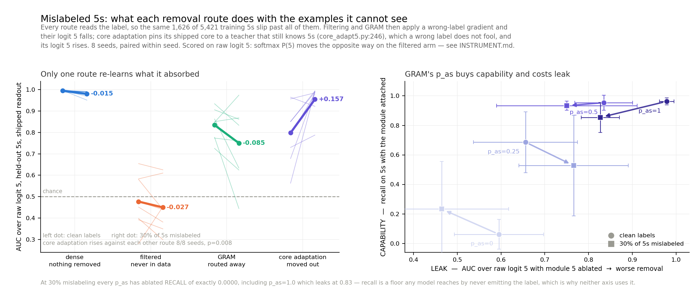
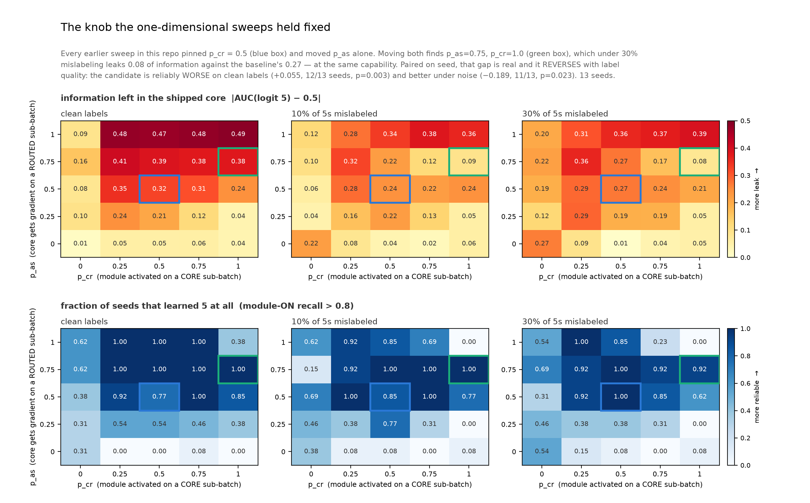
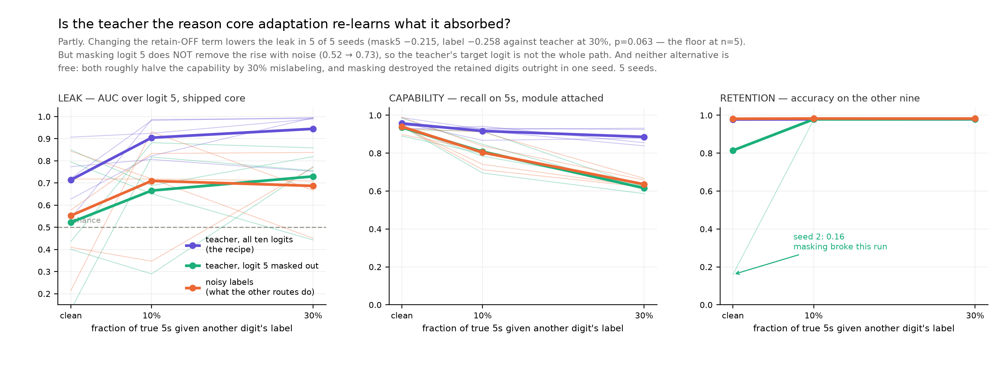

# What mislabeled 5s do to each removal route

2026-10-21 · **AI-generated implementation and prose (Claude); human review pending.**
8 seeds. Read `INSTRUMENT.md` first — it decides which of two AUCs this page is quoting.



<sub>Per-seed detail and the softmax/raw contrast: `figures/absorb3.png`.</sub>

## What "leak" means here

**Leak = AUC over raw logit 5 on the held-out test set** — the 892 true 5s as positives
against the other 9,108 — with the model in **the configuration it ships in** (module 5
detached for GRAM, core-only for filtering and core adaptation).

| value | reading |
|---|---|
| 0.5 | the shipped readout orders 5s and non-5s no better than a coin |
| 1.0 | logit 5 is a working 5-detector |
| **below 0.5** | **anti-ranking** — 5s get systematically *lower* logit 5 than non-5s. Still information, just sign-flipped, which is why filtering at 0.40 is not "clean" |

**It does not mean the model emits a 5.** Ablated recall is 0.0000 in nearly every cell here,
including the p_as=1.0 cell that leaks at 0.827. Nothing outputs the label; the ordering
survives.

That ordering is the quantity with a threat model attached. `results/elicit_three.json`: **50
labeled 5s bring all three removal routes within 0.7 AUC points of the model that never
removed anything.** An attacker does not need the model to emit a 5, only for logit 5 to rank,
and then a threshold on it. Argmax is the quantity that looks reassuring and is not.

## Every route reads the same oracle

All three removal routes decide what to remove by reading the **label**:

| route | the decision | where |
|---|---|---|
| `filter_no5` | drop examples whose label is 5 | `train.py:108` |
| `gram_main` | route examples whose label is 5 into module 5 | `train.py:120` |
| `core_adapt5` | split target from retain on whether the label is 5 | `core_adapt5.py:166` |

So a true 5 wearing another digit's label is invisible to all three, **identically**. At a 30%
`fn5` rate that is 1,626 of the 5,421 training 5s, absorbed into the part every route ships.
Absorption *volume* is therefore not what separates these methods, and this is a fact about the
code rather than a measurement.

What separates them is the gradient each mechanism then applies to the image it failed to
catch, and the three mechanisms differ sharply:

- **filtering** and **GRAM** hand it ordinary cross-entropy toward a **wrong digit**
- **core adaptation** hands it the retain-OFF term, `kl(s_off_r, tr_)` at weight 2.0
  (`core_adapt5.py:246`), which pins the **shipped** core to the **teacher's** output — and
  the teacher is the donor, which still recognizes 5s. **The label is wrong; the teacher is
  not fooled by it.**

## The result

Paired within seed, raw logit 5 on held-out 5s, clean labels to 30% mislabeled, 8 seeds:

| route | r=0 | r=0.3 | mean delta | seeds up | sign p |
|---|---:|---:|---:|:---:|---:|
| dense — nothing removed | 0.9954+-0.003 | 0.9806+-0.014 | **-0.0149** | 0/8 | 0.008 |
| filtered | 0.4769+-0.115 | 0.4495+-0.109 | **-0.0274** | 2/8 | 0.289 |
| GRAM | 0.8346+-0.066 | 0.7501+-0.161 | **-0.0845** | 2/8 | 0.289 |
| **core adaptation** | 0.7980+-0.129 | 0.9550+-0.067 | **+0.1569** | 7/8 | 0.070 |

Seed spread reaches +-0.16, larger than several of these effects, so the unpaired column
cannot carry the claim. The paired contrast can:

| contrast | mean | seeds | sign p |
|---|---:|:---:|---:|
| core adaptation − dense | +0.1718 | **8/8** | **0.008** |
| core adaptation − filtered | +0.1843 | **8/8** | **0.008** |
| core adaptation − GRAM | +0.2414 | **8/8** | **0.008** |

0.008 is the smallest two-sided p a sign test can return at n=8. **Core adaptation's logit-5
ranking rises under mislabeling while every other route's falls, in every seed.**

Both halves match the mechanism. The wrong-label CE really does suppress logit 5 — filtering
-0.027, GRAM -0.085 — which is what a gradient saying "this is not a 5" should do. Core
adaptation instead distills the teacher's own distribution onto exactly those images, and the
teacher reads them correctly whatever the label says.

## The GRAM knob: false negatives raise the p_as you need

`p_as` (`train.py:188`) is the probability the core receives gradient on a routed-5
sub-batch -- the only channel that teaches the core "5-pixels -> 5". It is simultaneously the
leak. A false negative is never routed, so it reaches the core at **every** p_as, through the
core sub-batch, which is unconditional. One leak is tunable and one is not.

8 seeds. LEAK is ablated raw logit 5 (lower = better removal); CAPABILITY is module-ON recall
on 5s (did the model ever learn 5 at all):

| p_as | LEAK clean | LEAK r=0.3 | CAPABILITY clean | CAPABILITY r=0.3 |
|---:|---:|---:|---:|---:|
| 0.0 | 0.595+-0.102 | 0.464+-0.153 | 0.061+-0.101 | 0.233+-0.322 |
| 0.25 | 0.656+-0.119 | 0.766+-0.125 | 0.686+-0.206 | 0.527+-0.341 |
| **0.5** | 0.835+-0.066 | **0.750+-0.161** | 0.953+-0.051 | **0.934+-0.030** |
| 1.0 | 0.979+-0.017 | 0.827+-0.043 | 0.963+-0.023 | 0.854+-0.102 |

On clean labels you buy capability with leak and would pick the smallest p_as that works:
0.25, capability 0.686 at leak 0.656. **Under 30% false negatives that choice is gone.** p_as
0.25 drops to 0.527+-0.341 -- the +-0.34 is bimodal, some seeds learn 5s and some never do --
while p_as=0.5 holds at 0.934+-0.030 for the *same* leak (0.750 against 0.766, overlapping).
Under false negatives **p_as=0.5 strictly dominates p_as=0.25**: nearly double the capability
at no extra leak. Raising p_as there is not a tradeoff, it is free.

What is lost is the ability to buy a cleaner core by turning p_as down. The softmax range
across settings compresses from 0.30 clean to 0.08 under noise, and in the raw column the
three usable settings all land at 0.75-0.83.

### A cell that did not survive seeding

At n=3, `p_as=0, r=0.3` looked like the best point on the frontier -- leak 0.289 with
capability 0.620+-0.192, low leak *and* a half-working capability, the capability arriving
through the `p_cr` absorption side channel rather than p_as at all. At n=8 its capability per
seed is `0.822, 0.677, 0.361, 0.001, 0.000, 0.000, 0.001, 0.000`: three seeds learn something
and five learn nothing. Seeds 0-2 happened to be the three that worked. It is a coin flip, not
an operating point, and it is recorded here because an n=3 frontier figure would have shipped
it as the recommendation.

### Recall cannot see any of this

At 30% mislabeling **every** p_as has ablated recall of exactly 0.0000 -- including p_as=1.0,
whose ablated raw-logit AUC is 0.827. On clean labels p_as=1.0 has ablated recall 0.365+-0.167,
visibly broken suppression. So by recall, label noise *repairs* GRAM's ablation at every
setting, while by AUC the leak is 0.75-0.83 throughout. Recall is a floor any model reaches by
never emitting the label.

## Why this matters beyond the toy

The other two routes degrade *gracefully* under label noise: the leaked examples make the
shipped model slightly worse at ranking 5s, and cleaner labels would directly buy less leakage.

Core adaptation has a leak path that **does not depend on the label at all**. Its retention
objective re-teaches the capability on precisely the examples its removal objective failed to
identify, and no amount of label cleaning closes that path — only a teacher that does not know
the capability would, which defeats the purpose of having one. Any distillation-based removal
that pins a student to a teacher on a "retain" set defined by labels inherits this, and the
200M campaign's core adaptation arm is built the same way.

## The second knob: p_cr



Every sweep above pinned `p_cr = 0.5` and moved `p_as` alone. `p_cr` (train.py:180) is the
probability a random module is forward-activated AND updated on a CORE sub-batch -- and a
mislabeled 5 sits in exactly that sub-batch. Moving both knobs, 13 seeds:

| setting | info \|leak-0.5\|, 30% noise | capability | usable seeds |
|---|---:|---:|---:|
| p_as=0.5, p_cr=0.5 (every earlier sweep) | 0.271 | 0.932 | 13/13 |
| **p_as=0.75, p_cr=1.0** | **0.082** | 0.927 | 12/13 |

Paired on seed, the gap is real **and it reverses with label quality**: the second setting is
reliably WORSE on clean labels (+0.055, 12/13 seeds, p=0.003) and better under 30% mislabeling
(-0.189, 11/13, p=0.023). Both directions significant.

Scored as |leak-0.5|, not raw AUC. Ranking by raw AUC would crown the `p_cr=0` column (leak
0.23-0.35 at 30%), but those cells are *below* chance -- anti-ranked, not clean.

**The caveat that blocks a recommendation.** The candidate's per-seed leak spans 0.337 to
0.785, straddling chance, against the baseline's tighter 0.585-0.940. And since the better
setting depends on which noise regime you are in, you cannot tune this without already knowing
your label error rate.

## Is the teacher the cause? Partly



`retain_target.py` changes only the retain-OFF term, on the same donor, seed and noise
realisation. 5 seeds:

| variant | leak, clean | leak, 30% | capability, 30% |
|---|---:|---:|---:|
| teacher (the recipe) | 0.714 | 0.945 | 0.886 |
| teacher, logit 5 masked | 0.522 | 0.730 | 0.616 |
| noisy labels | 0.553 | 0.687 | 0.636 |

**The term is part of the path.** Both alternatives lower the leak against the teacher in 5 of
5 seeds (mask5 -0.215, label -0.258, p=0.0625 -- the floor at n=5).

**But masking logit 5 does not remove the rise with noise** (0.522 -> 0.730). So the teacher's
target logit is not the whole route, and the prediction that masking would collapse the effect
was wrong.

**And neither alternative is free.** Both roughly halve the capability by 30% mislabeling
(0.616, 0.636 against 0.886). Masking also destroyed the retained digits outright in one seed
-- other-nine accuracy 0.159 at clean labels -- so it is not a drop-in fix. n=5; p=0.0625
cannot reach significance at that size.

## What is not established

- **MNIST, one architecture, one target digit.** Nothing here says how the effect scales.
- **`fn5` only.** `fp5` (non-5s mislabeled '5') and `swap57` are not run. `swap57` is the
  interesting gap: it routes mislabeled 5s into *module 7* rather than the core, a third
  mechanism neither sweep covers.
- Core adaptation's own r=0 to r=0.3 rise is 7/8 (p=0.070). Only the *differential* against
  the other routes reaches 8/8. Seed 7 fell — but every other route fell further on seed 7,
  which is why the contrast holds.
- The donor is retrained per noise rate on the noisy labels, which is the realistic setup but
  means the donor's own 5-knowledge varies across the sweep and is not separately controlled.

## Reproduce

```bash
sbatch job_absorb.sh --kind fn5 --rates 0.0 0.3 --cycles 60 --seed 0 --out results/absorb3_seed0.json
python figs_absorb3.py          # reads every results/absorb3_seed*.json it finds
```

`absorb_raw.py` rescores saved checkpoints three ways without retraining. `gate5.py` is the
capability gate both statistics must pass before either is read as capability.
