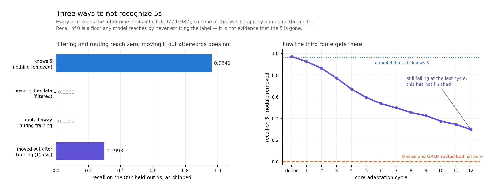
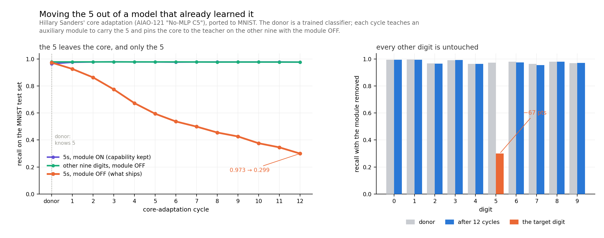

# Three ways to not recognize 5s

2026-10-20 · **AI-generated implementation and prose (Claude); human review pending.**

This repo's GRAM arms route gradients **during** training: the aux module is told about 5 from
the start, so the core never learns it. Hillary Sanders' AIAO-121 core adaptation asks the
harder question — **can you take a model that already knows 5 and move that knowledge out of
its core afterwards?**

That gives a third way to not recognize 5s, alongside the two already here:

| route | when the 5 is dealt with | this repo |
|---|---|---|
| never in the data | before training | `filter_no5` |
| routed away | during training | `ablate5` |
| **moved out afterwards** | **after training** | **`core_adapt5.py` (new)** |

## All three routes, measured the same way



| route | ships as | recall on 5 | other nine |
|---|---|---:|---:|
| knows 5 (nothing removed) | core only | 0.9641 | 0.9799 |
| never in the data (`filter_no5`) | core only | **0.0000** | 0.9820 |
| routed away in training (`gram_main`) | ablate5 = (0,1) | **0.0000** | 0.9765 |
| moved out afterwards (`core_adapt5`) | (0,0) | **0.2993** | 0.9767 |

**Filtering and training-time routing both reach exactly zero. Core adaptation, after 12
cycles, does not — it still gets 30% of held-out 5s right.** No route damaged the model: every
arm holds the other nine digits at 0.977–0.982.

Two things that number does *not* settle:

**It has not finished.** The curve is still falling at cycle 12 and has not saturated. Where it
stops is unmeasured.

**Recall of zero is a floor any model reaches by never emitting the label.** It is not evidence
that the 5 is gone — and this repo's own headline result is precisely that the filtered model's
probe sits *below* chance, an anti-ranking fingerprint, while the information stays decodable
through the trunk. So the right reading of the table is that these three routes differ in **how
completely they suppress the output**, and say nothing yet about what each one removed.

That makes the probe and attack comparison the interesting half of this ticket, not an
afterthought. `layer_probe5.py` and `attack5.py` are already here and neither has been run
against the adapted checkpoint.

## How core adaptation gets there



Over 12 cycles, with the module removed, recall on 5 falls **0.973 → 0.299** while the other
nine digits move **0.9782 → 0.9767**. With the module *on*, recall on 5 is **0.977** — higher
than the donor's 0.964.

Three numbers, and they only mean something together:

- **the capability leaves the shipped model** — 67 points of 5-recall, monotone across cycles
- **nothing else moves** — 0.15 points on the other nine, which is the `2×KL_retain(teacher‖core)`
  term doing its job
- **the capability still exists** — with the module on it is intact, so this is relocation, not
  damage. A method that merely broke the model would drop both.

## The method

Transcribed from `experiments/AIAO-121-core-adaptation/current_method.json` (v5,
`fullreplace-c5`) in the GRAM repo, with the language-model shapes mapped onto this MLP:

| | |
|---|---|
| donor | a trained classifier whose **core** knows 5 |
| teacher | an independent frozen copy of the donor |
| core scope | the block core MLPs; embed and head frozen |
| per cycle | 512 aux updates with the **core dropped** (the module must carry 5 alone), then 8 × (64 aux, 64 core) alternating with the module on |
| core loss | `KL₅(teacher‖core+aux) + KL_retain(teacher‖core+aux) + 2·KL_retain(teacher‖core alone)` |
| aux loss | CE+KL on 5 through the live route, + 0.25·(CE+KL) on retain |
| lr | aux 2e-4, core 1e-5 — **used as published, not retuned** |

The third loss term is the mechanism: it pins the core to teacher behaviour on non-5 digits
*with the module off*, which is the state the model ships in.

## Run it

```bash
python3 core_adapt5.py --cycles 12          # trains a donor if none is given, then adapts
python3 figs_core_adapt5.py                 # redraws the figure from results/
```

Needs only torch and numpy. MNIST is read straight from the IDX files, because `train.py`
imports torchvision at module scope and not every environment has it. 48 seconds on one H200,
including training the donor.

## What this does not show

**It has not forgotten 5.** 0.299 recall is a long way from the ~0 you would want from a
deletion, and the curve is still falling at cycle 12 — it has not saturated. How far it goes,
and whether it ever reaches zero, is unmeasured.

**One seed.** Every number here is a single run.

**The custody law is untested on this arm.** This repo's headline is that *routing decides who
holds the switch, not where the knowledge lives*. Whether post-hoc core adaptation behaves the
same way is exactly the interesting question, and the machinery to answer it is already here:
`layer_probe5.py` for whether 5-information survives in the trunk, `attack5.py` for how many
gradient steps bring it back. Neither has been run against this checkpoint.

Until those run, this is a demonstration that the method ports and works — not a claim about
what it removes.
